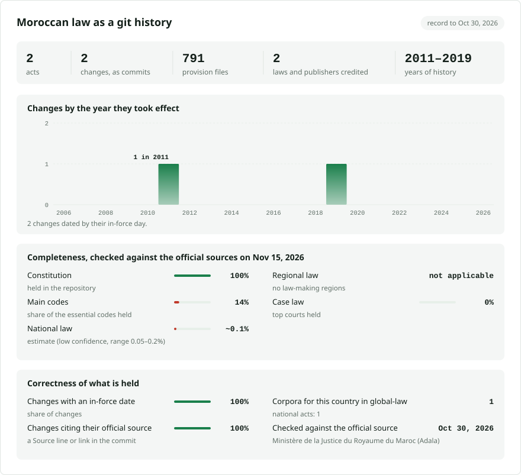

# Morocco: law history in git

[Français](README.md) · **English**

<picture>
<source media="(prefers-color-scheme: dark)" srcset="data/effort-dark.svg">

</picture>

The law of Morocco as a git history: one file per article, one commit per version on the day it took effect, and the law that made each change as the commit's author. `git blame` names the law behind every line; `git log` lists every change to an article; picking a date gives the text in force that day.

Part of [lexifina/global-law](https://github.com/lexifina/global-law), one git history for every country's law: this is Morocco's national law, which global-law reads at `morocco/national/acts/`.

**What is in it now:** 299 texts, one version each: the 2011 Constitution; 7 codes ([code-de-commerce](codes/code-de-commerce/), [code-de-commerce-maritime](codes/code-de-commerce-maritime/), [code-de-la-presse-et-de-ledition-2003](codes/code-de-la-presse-et-de-ledition-2003/), [code-de-procedure-civile](codes/code-de-procedure-civile/), [code-des-droits-reels](codes/code-des-droits-reels/), [code-des-obligations-et-contrats](codes/code-des-obligations-et-contrats/), [code-penal](codes/code-penal/)); 50 lois, 15 dahirs, 91 décrets and 135 arrêtés, filed by type and year ([STRUCTURE.md](STRUCTURE.md); full list in [`corpus.json`](corpus.json)). Decisions of the Cour constitutionnelle are in a separate repository.

Each act is a folder with one file per article, `<folder>/art-NNN.md` (`constitution/art-001.md` is Article premier of the Constitution, `codes/code-penal/art-262-bis.md` Article 262 bis of the Code pénal); `constitution/preambule.md` is the preamble.

The text is in French: the Ministry of Justice's French version of the Constitution, the Ministry of Justice's consolidated codes as republished by WIPO Lex, and Bulletin officiel texts (French edition) as copied by FAOLEX and WIPO Lex. The authoritative text is the Arabic one in the Bulletin officiel; it and an English translation are not part of this record.

## Questions as git commands

| Question | Command |
| --- | --- |
| Every change to Article 1 of the Constitution | `git log -p --word-diff -- constitution/art-001.md` |
| Which law wrote each line of Article 1? | `git blame constitution/art-001.md` |
| Every version of the Constitution, with the day each took effect | `git log --format="%h %(trailers:key=In-force,valueonly,separator=) %an" -- "constitution/art-*"` |
| Article 1 as in force on 1 January 2026 | `python tools/on.py 2026-01-01 constitution art-001` |

Each act has one version here, so each list has one entry.

**Outside git**, we also host this record publicly, for free:

- **[Ask Claude about Moroccan law](https://global-law.lexifina.com/v1/try_claude?country=morocco)**: opens Claude with a first question ready.
- **[Ask ChatGPT](https://global-law.lexifina.com/v1/try_chatgpt?country=morocco)**: the same question in ChatGPT.
- **[Search Moroccan law on our site](https://lexifina.com/law?country=morocco&q=vol)**: a search for "vol" (theft), with each provision's text and its versions, no account needed.
- **[Developer REST API](https://global-law.lexifina.com/v1/search_law?query=vol&jurisdiction=morocco)**: the same search as JSON, with no key. See the [documentation here](https://lexifina.com/api/global-law).

Both assistants read the record through the free Global law connector (MCP, `https://global-law.lexifina.com/mcp`); the first time, the chat gives you the link that adds it. Ask in French or in English.

**Host it yourself easily.** All it takes is git and Python, and the tools run on your machine:

```sh
git clone --depth 1 https://github.com/lexifina/global-law && cd global-law
python3 tools/countries.py add morocco/national/acts
python3 tools/law.py show 2026-01-01 morocco/national/acts/constitution/art-001.md
```

Opened in Claude Code, Cursor, VS Code or Codex, the clone also starts a local MCP server with the same tools ([MCP.md](https://github.com/lexifina/global-law/blob/main/MCP.md)).

## Dates

Each commit is dated at noon, Africa/Casablanca, on the day the version took effect, and carries it in its `In-force:` trailer:

- the Constitution: 30 July 2011, the day it appeared in the Bulletin officiel n° 5964 bis; it was adopted by referendum on 1 July 2011, and Dahir n° 1-11-91 promulgating it is dated 29 July 2011 (the `Enacted:` trailer);
- the Code pénal: 11 March 2019, the date of dahir n° 1-19-44, which promulgated loi n° 33-18, the last amendment the consolidated text takes in;
- the other consolidated codes: the "version consolidée du …" day printed by the Ministry of Justice (DOC and Code de commerce: 19 December 2019; Code de procédure civile: 6 June 2013);
- every other text: its own entry-into-force rule applied to the general (Arabic) edition of the Bulletin officiel it cites, else the Bulletin officiel day in the FAOLEX record (Moroccan texts take effect on publication unless they say otherwise), else the WIPO Lex record's entry-into-force or publication day, else the date of the text; the `In-force-basis:` trailer says which. Before 1970 the commit is dated 1 January 1970 and the real day is in the subject and in `In-force:`.

The Constitution is credited to `Dahir n° 1-11-91`. The Code pénal, here only in the oldest version available, is credited to the publisher as the repository names it, `Ministère de la Justice du Royaume du Maroc (Adala)`, although its text comes from WIPO Lex. The committer is Lexifina.

## How it is checked

- `tools/check_repo.py` reads every version back from git on the day it took effect and on the day before, compares it file by file with the corpus it was built from, and checks that every commit's trailers parse, with no merge commits and no commit dated in the future.
- The same corpus always gives the same commit hashes; [`REPRODUCE.md`](REPRODUCE.md) gives the corpus's sha256, the builders' blob hashes and the decisions made by hand. It also records that, for the published build, that check had not yet been run and no second build had been compared.
- Every text comes from a PDF with a text layer and is reproduced unchanged apart from layout; Lexifina ran no OCR. 5 texts rest on a text layer the publisher laid over a scan (trailer `Text-source: publisher OCR`); noisy copies are left out.
- [vulnerabilities/](vulnerabilities/README.en.md): possible drafting mistakes in this law, found by global-law's detectors and checked by hand. Not run yet.

## What it does not show

- **Much of Moroccan law.** The official hosts (sgg.gov.ma, adala.justice.gov.ma) do not accept a connection from our machine, so only texts of which FAOLEX or WIPO Lex publish a readable French copy are here (1036 records left out: scans without a text layer, Arabic or English texts, duplicates, no reliable date). The Code de la famille (2004) and the Code de procédure pénale are missing: no readable French copy was found. The Code du travail (2003) is held: no source held here confirms its in-force day.
- **The history of each text.** Each text has one version, as published (or consolidated); amending laws are not applied as separate versions.
- **The Code pénal's history.** It is one consolidated text: not the 1962 text, the amending laws are not separate versions, and amendments made after loi n° 33-18 are not applied.
- **Eight articles of the Code pénal.** Articles 19 to 23 are missing from the WIPO Lex PDF's text layer, and articles 289 to 291 are not printed in it (repealed), so they have no file.
- **Headings and notes.** The Constitution's Titre headings and page numbers, the Code pénal's Livre, Titre, Chapitre and Section headings, and its footnotes naming each amending law are left out; the promulgating dahir is not a file.
- **The earlier Constitutions** (1962 to 1996).

## Sources

| Source | Kind | Past versions | Notes |
| --- | --- | --- | --- |
| [Adala](https://adala.justice.gov.ma/) (Ministère de la Justice) | Official portal, French version | the Constitution as promulgated, never amended | The Constitution, retrieved 28 October 2026 |
| [WIPO Lex](https://www.wipo.int/wipolex/en/legislation/details/19795) | Official text republished by WIPO (MA088) | one consolidated text | The Code pénal as amended to loi n° 33-18, retrieved 30 October 2026 |
| [WIPO Lex](https://www.wipo.int/wipolex/en/legislation/members/profile/MA) | Ministry of Justice consolidated texts and published texts, republished by WIPO (secondary copy) | one text per code | DOC, Code de commerce, Code de procédure civile and other texts, retrieved 27 November 2026 |
| [FAOLEX](https://faolex.fao.org/) (FAO) | Bulletin officiel texts (French edition) copied by FAO (secondary copy) | the published text | Lois, dahirs, décrets and arrêtés; Bulletin officiel number and day from the record; retrieved 27 November 2026 |

## Licence

See [`LICENSE`](LICENSE). Moroccan loi n° 2-00, article 8(a), excludes official legislative texts from copyright protection; no source states a licence for these texts. Lexifina's arrangement of the repository, its tables, commit messages and tools are dedicated to the public domain (CC0 1.0).

No AI model wrote, translated or corrected legal text, and none runs at build time; the scripts were written by Claude Code (see [`REPRODUCE.md`](REPRODUCE.md)).

## Visualisations

- [visualisations/](visualisations/README.en.md): charts drawn from this repository. Not drawn yet.

## More

From [lexifina/global-law](https://github.com/lexifina/global-law):

- [FEATURES.md](https://github.com/lexifina/global-law/blob/main/FEATURES.md): every feature, and what every corpus must support (`git blame`, `law.py`, the MCP tools)
- [FAQ.md](https://github.com/lexifina/global-law/blob/main/FAQ.md): questions and answers · [CONTRIBUTING.md](https://github.com/lexifina/global-law/blob/main/CONTRIBUTING.md): proposing changes · [MCP.md](https://github.com/lexifina/global-law/blob/main/MCP.md): the MCP server · [REPRODUCE.md](https://github.com/lexifina/global-law/blob/main/REPRODUCE.md): how it was built · [CHANGELOG.md](https://github.com/lexifina/global-law/blob/main/CHANGELOG.md)
- [FRESHNESS.md](https://github.com/lexifina/global-law/blob/main/FRESHNESS.md): how current each corpus is · [Monitoring](https://github.com/lexifina/global-law/tree/main/monitoring): whether updates are running · [WATCHING.md](https://github.com/lexifina/global-law/blob/main/WATCHING.md): how each official source is watched for changes
- [performance/](https://github.com/lexifina/global-law/tree/main/performance): how fast the tools are, measured
- [visualisations/](https://github.com/lexifina/global-law/tree/main/visualisations): charts and bridges across the world's law
- [Vulnerabilities](https://github.com/lexifina/global-law/tree/main/vulnerabilities): mistakes in legislation as published
