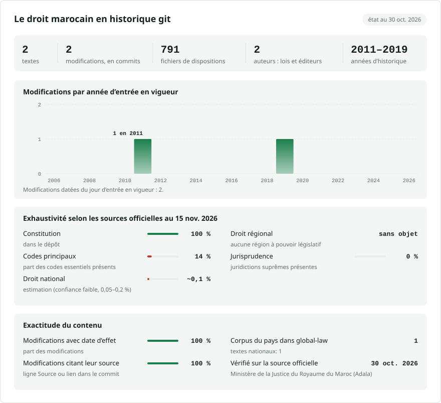

# Maroc : l’histoire du droit dans git

**Français** · [English](README.en.md)

<picture>
<source media="(prefers-color-scheme: dark)" srcset="data/fr/effort-dark.svg">

</picture>

Le droit du Maroc sous la forme d’un historique git : un fichier par article, un commit par version à la date de son entrée en vigueur, et la loi auteur de chaque modification comme auteur du commit. `git blame` indique la loi à l’origine de chaque ligne ; `git log` liste toutes les modifications d’un article ; le choix d’une date donne le texte en vigueur ce jour-là.

Fait partie de [lexifina/global-law](https://github.com/lexifina/global-law), un historique git unique pour le droit de tous les pays : il s’agit ici du droit national du Maroc, que global-law lit sous `morocco/national/acts/`.

**Contenu actuel :** deux textes, en une version chacun : la Constitution de 2011 (son préambule et 180 articles), telle que promulguée et non modifiée depuis, et le Code pénal de 1962 dans sa version consolidée jusqu’à la loi n° 33-18 de 2019 (608 articles). Le dossier de chaque texte contient un `README.md` listant ses articles ; [`data/versions.json`](data/versions.json) donne la date et la source de chaque version.

Chaque texte est un dossier avec un fichier par article, `<act>/art-NNN.md` (`constitution/art-001.md` est l’article premier de la Constitution, `code-penal/art-262-bis.md` l’article 262 bis du Code pénal) ; `constitution/preambule.md` est le préambule.

Le texte est en français : la version française de la Constitution publiée par le Ministère de la Justice, et la copie du Code pénal de WIPO Lex. Le texte qui fait foi est le texte arabe publié au Bulletin officiel ; ni celui-ci ni une traduction anglaise ne font partie de ce corpus.

## Questions sous forme de commandes git

| Question | Commande |
| --- | --- |
| Toutes les modifications de l’article premier de la Constitution | `git log -p --word-diff -- constitution/art-001.md` |
| Quelle loi a rédigé chaque ligne de l’article premier ? | `git blame constitution/art-001.md` |
| Toutes les versions de la Constitution, avec la date d’entrée en vigueur de chacune | `git log --format="%h %(trailers:key=In-force,valueonly,separator=) %an" -- "constitution/art-*"` |
| L’article premier tel qu’en vigueur au 1er janvier 2026 | `python tools/on.py 2026-01-01 constitution art-001` |

Chaque texte n’ayant ici qu’une version, chaque liste ne comporte qu’une entrée.

**En dehors de git**, nous hébergeons aussi ce corpus publiquement, gratuitement :

- **[Interroger Claude sur le droit marocain](https://global-law.lexifina.com/v1/try_claude?country=morocco)** : ouvre Claude avec une première question prête.
- **[Interroger ChatGPT](https://global-law.lexifina.com/v1/try_chatgpt?country=morocco)** : la même question dans ChatGPT.
- **[Rechercher dans le droit marocain sur notre site](https://lexifina.com/law?country=morocco&q=vol)** : une recherche de « vol », avec le texte de chaque disposition et ses versions, sans compte.
- **[API REST pour développeurs](https://global-law.lexifina.com/v1/search_law?query=vol&jurisdiction=morocco)** : la même recherche au format JSON, sans clé. Voir la [documentation ici](https://lexifina.com/api/global-law).

Les deux assistants lisent le corpus au moyen du connecteur gratuit Global law (MCP, `https://global-law.lexifina.com/mcp`) ; la première fois, la conversation vous donne le lien qui l’ajoute. Posez vos questions en français ou en anglais.

**L’héberger vous-même, simplement.** Il suffit de git et de Python, et les outils s’exécutent sur votre machine :

```sh
git clone --depth 1 https://github.com/lexifina/global-law && cd global-law
python3 tools/countries.py add morocco/national/acts
python3 tools/law.py show 2026-01-01 morocco/national/acts/constitution/art-001.md
```

Ouvert dans Claude Code, Cursor, VS Code ou Codex, le clone démarre aussi un serveur MCP local doté des mêmes outils ([MCP.md](https://github.com/lexifina/global-law/blob/main/MCP.md)).

## Dates

Chaque commit est daté à midi, heure Africa/Casablanca, du jour où la version est entrée en vigueur, et porte cette date dans son trailer `In-force:` :

- la Constitution : le 30 juillet 2011, date de sa parution au Bulletin officiel n° 5964 bis ; elle a été adoptée par référendum le 1er juillet 2011, et le Dahir n° 1-11-91 portant sa promulgation est daté du 29 juillet 2011 (le trailer `Enacted:`) ;
- le Code pénal : le 11 mars 2019, date du dahir n° 1-19-44 portant promulgation de la loi n° 33-18, dernière modification intégrée dans le texte consolidé.

La Constitution est attribuée au `Dahir n° 1-11-91`. Le Code pénal, présent ici uniquement dans la plus ancienne version disponible, est attribué à l’éditeur sous le nom que lui donne le dépôt, `Ministère de la Justice du Royaume du Maroc (Adala)`, bien que son texte provienne de WIPO Lex. Le committer est Lexifina.

## Méthode de vérification

- `tools/check_repo.py` relit chaque version dans git le jour de son entrée en vigueur et la veille, la compare fichier par fichier au corpus à partir duquel elle a été construite, et vérifie que les trailers de chaque commit sont analysables, sans commit de fusion ni commit daté dans le futur.
- Un même corpus donne toujours les mêmes empreintes de commit ; [`REPRODUCE.md`](REPRODUCE.md) donne l’empreinte sha256 du corpus, les empreintes de blob des scripts de construction et les choix faits manuellement. Il consigne également que, pour la construction publiée, ce contrôle n’avait pas encore été exécuté et qu’aucune seconde construction n’avait été comparée.
- Les deux textes proviennent de PDF dotés d’une couche texte et sont reproduits sans modification, hormis la mise en page.
- [vulnerabilities/](vulnerabilities/): erreurs de rédaction possibles dans ce droit, trouvées par les détecteurs de global-law et vérifiées à la main. Pas encore lancé.

## Ce qu’il ne montre pas

- **L’essentiel du droit marocain.** Seuls ces deux textes figurent ici : aucune autre loi, aucun autre dahir ou décret, et aucune jurisprudence.
- **L’historique du Code pénal.** Il s’agit d’un texte consolidé unique : le texte de 1962 n’y figure pas, les lois modificatives ne constituent pas des versions distinctes, et les modifications postérieures à la loi n° 33-18 ne sont pas appliquées.
- **Huit articles du Code pénal.** Les articles 19 à 23 sont absents de la couche texte du PDF de WIPO Lex, et les articles 289 à 291 n’y sont pas imprimés (abrogés) ; ils n’ont donc pas de fichier.
- **Les intitulés et les notes.** Les intitulés des Titres et les numéros de page de la Constitution, les intitulés des Livres, Titres, Chapitres et Sections du Code pénal ainsi que ses notes de bas de page désignant chaque loi modificative sont omis ; le dahir de promulgation ne fait pas l’objet d’un fichier.
- **Les Constitutions antérieures** (1962 à 1996).

## Sources

| Source | Nature | Versions antérieures | Remarques |
| --- | --- | --- | --- |
| [Adala](https://adala.justice.gov.ma/) (Ministère de la Justice) | Portail officiel, version française | la Constitution telle que promulguée, jamais modifiée | La Constitution, consultée le 28 octobre 2026 |
| [WIPO Lex](https://www.wipo.int/wipolex/en/legislation/details/19795) | Texte officiel republié par l’OMPI (MA088) | un texte consolidé | Le Code pénal tel que modifié jusqu’à la loi n° 33-18, consulté le 30 octobre 2026 |

## Licence

Voir [`LICENSE`](LICENSE). La loi marocaine n° 2-00, en son article 8(a), exclut les textes législatifs officiels de la protection du droit d’auteur ; aucune des deux sources n’indique de licence. L’organisation du dépôt par Lexifina, ses tableaux, ses messages de commit et ses outils peuvent être réutilisés sous licence CC BY 4.0.

Aucun modèle d’IA n’a rédigé, traduit ni corrigé de texte juridique, et aucun ne s’exécute lors de la construction ; les scripts ont été écrits par Claude Code (voir [`REPRODUCE.md`](REPRODUCE.md)).

Ceci est une traduction de la version anglaise ([README.en.md](README.en.md)) ; en cas de divergence, la version anglaise fait foi.

## Visualisations

- [visualisations/](visualisations/): graphiques tirés de ce dépôt. Pas encore dessinés.

## En savoir plus

Dans le dépôt [lexifina/global-law](https://github.com/lexifina/global-law) (pages en anglais) :

- [FEATURES.md](https://github.com/lexifina/global-law/blob/main/FEATURES.md): toutes les fonctionnalités et ce que chaque corpus doit prendre en charge (`git blame`, `law.py`, outils MCP)
- [FAQ.md](https://github.com/lexifina/global-law/blob/main/FAQ.md): questions et réponses · [CONTRIBUTING.md](https://github.com/lexifina/global-law/blob/main/CONTRIBUTING.md): proposer une modification · [MCP.md](https://github.com/lexifina/global-law/blob/main/MCP.md): serveur MCP · [REPRODUCE.md](https://github.com/lexifina/global-law/blob/main/REPRODUCE.md): comment il a été construit · [CHANGELOG.md](https://github.com/lexifina/global-law/blob/main/CHANGELOG.md)
- [FRESHNESS.md](https://github.com/lexifina/global-law/blob/main/FRESHNESS.md): à quel point chaque corpus est à jour · [Surveillance](https://github.com/lexifina/global-law/tree/main/monitoring): si les mises à jour fonctionnent · [WATCHING.md](https://github.com/lexifina/global-law/blob/main/WATCHING.md): comment chaque source officielle est surveillée pour repérer les modifications
- [performance/](https://github.com/lexifina/global-law/tree/main/performance): la rapidité des outils, mesurée
- [visualisations/](https://github.com/lexifina/global-law/tree/main/visualisations): graphiques et liens à travers le droit du monde entier
- [Vulnérabilités](https://github.com/lexifina/global-law/tree/main/vulnerabilities): erreurs dans les textes tels qu’ils ont été publiés
